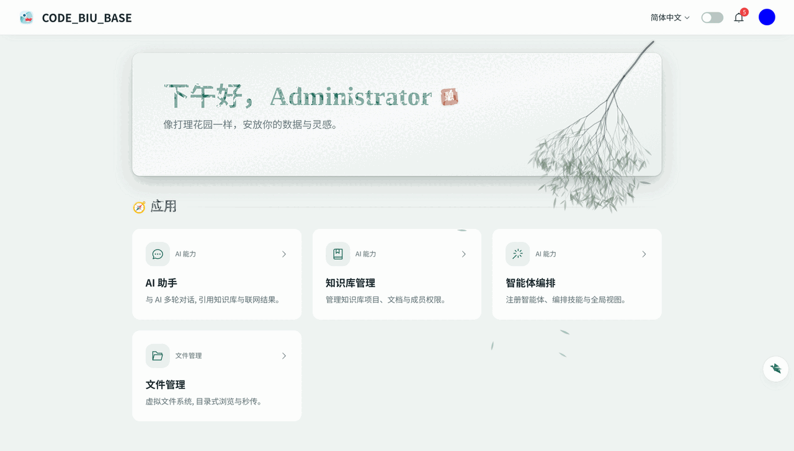
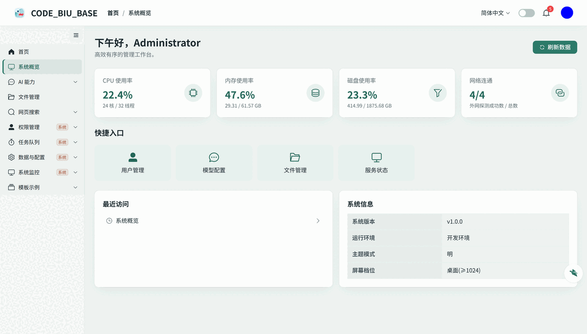
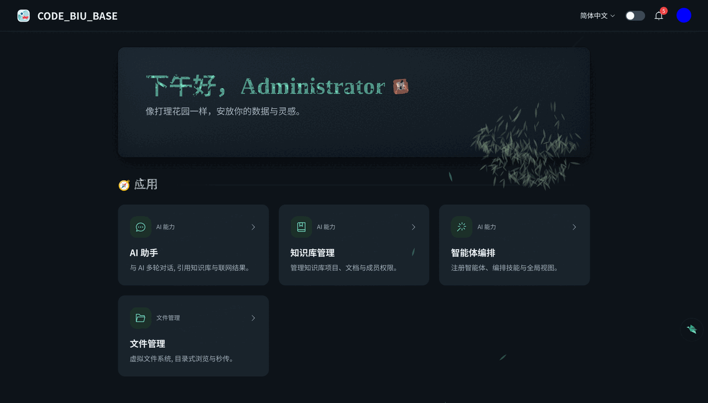
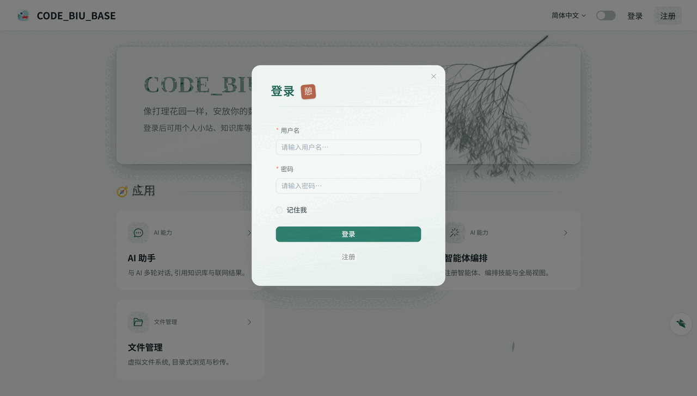
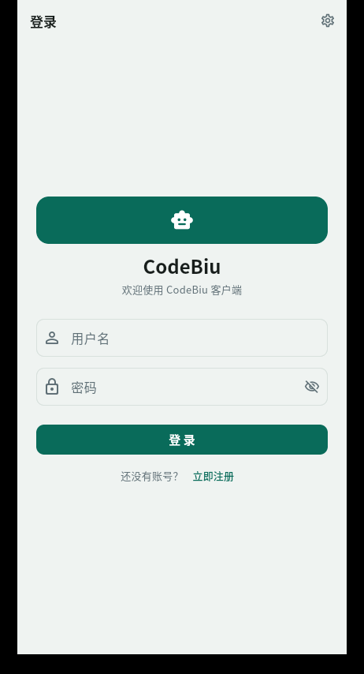
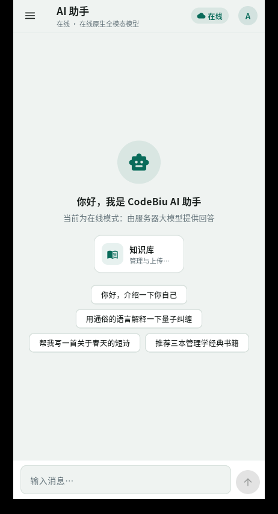
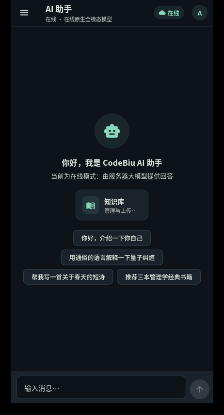

# codebiu_base

[简体中文](README.md) ｜ **English**

A next-generation **AI capability platform baseline**: **Model / Skill / Agent** as three first-class citizens are the architectural spine, with decoupled frontend and backend plus documentation and DevOps out of the box. The reusable foundation is kept — registration and login, RBAC, files, dictionaries, dynamic configuration, RAG, task queue — and new projects can start by copying this repository, then extend by "classify into the three layers first, write business code second" without polluting the shared base.

## Screenshots

**Web app (Vue3, light / dark themes)**

<p align="center">
  
  
</p>
<p align="center">
  
  
</p>

**Cross-platform client (Flutter, phone-sized UI on mobile and PC desktop)**

<p align="center">
  
  
  
</p>

## Repository layout

```
codebiu_base/
├── code/backend/server_py/  # Backend: Python 3.13 + FastAPI + SQLAlchemy 2.0 (async) + PostgreSQL/SQLite
├── code/frontend/vue3/      # Web frontend: Vue3 + TypeScript + Vite + Element Plus + UnoCSS + Pinia
├── code/frontend/flutter/   # Cross-platform client: Flutter (Android/iOS/Linux/Windows/macOS, phone-sized UI)
├── doc/                     # Project-level docs: getting started / design / conventions / test reports / dev skills
│   ├── 02-设计文档/04-AI能力平台架构设计.md   # single source of truth for the three-layer contract
│   ├── 02-设计文档/05-对话智能体与执行协议设计.md
│   ├── 05-开发skill/        # plain Markdown prompt skills (drag into an AI IDE or let the AI discover them)
│   └── doc-manifest.yaml    # machine-readable doc inventory and code mappings
├── deveops/                 # DevOps: environment, Docker, build & release, init, upgrade, backup, app packaging
├── README.md                # Project overview (Simplified Chinese)
├── README.en.md             # Project overview (English, this file; mirror of the Chinese version)
└── README_AI.md             # Single entry point for AI IDEs (workflow + doc-first gate + layered rule map)
```

## Architectural spine: Model / Skill / Agent

The platform recognizes exactly three first-class citizens, with increasing abstraction and capability; each layer has **ai / static / hybrid** forms, and rule-based and AI capabilities are fully equal in contract, queueing and governance.

```text
Agent orchestration   ai_agent (ReAct) │ static_agent (fixed workflow) │ hybrid
      │               e.g. kb_ingest_agent, builtin_thinking, ops_agent
Skill capability      ai_skill │ static_skill │ hybrid
      │               e.g. doc_parse, doc_chunk_index, sys.container_*
Model supply          ai_model (chat/embeddings/rerank/ocr/asr/tts) │ static_func (deterministic functions)
      │               e.g. Qwen chat model, MinerU parser (wrapped by a Skill), hash/regex/validators
Service domain        domain logic / transactions / permission filtering / DAO (unchanged)
```

- **One-way dependency**: `Agent → Skill → Model (optional) → Service`; Model calls nothing, Skills never orchestrate each other, and Agents never call Agents.
- **Three entry points, one runtime**: Web Controller, Agent Tool Adapter and Celery Task Executor all converge on `SkillRuntime.invoke()`; each Skill has exactly one implementation, with inline / queued as two shells.
- **Runs without models**: `static_func / static_skill / rule Agent` work with zero model configuration; AI is never mandatory.
- **Classify before coding**: model or deterministic function → Model; a single reusable execution unit → Skill; multi-step orchestration or conversational context → Agent; plain CRUD / display → Controller + Service.

Authoritative contracts live in [04-AI能力平台架构设计](doc/02-设计文档/04-AI能力平台架构设计.md), and the conversational execution protocol in [05-对话智能体与执行协议设计](doc/02-设计文档/05-对话智能体与执行协议设计.md) (both Chinese).

## Core capabilities

| Layer / area | Capability |
| :--- | :--- |
| **Model supply** | Dynamic model configuration isolated by user / department with `public` / `dept` / `user` scopes, online-only LLM chat / embeddings / rerank / OCR / ASR / TTS, `static_func` registry for deterministic functions (hashing, format detection, regex extraction, validators) |
| **Skill capability** | Skill Manifest contract (input/output schema, idempotency keys, execution mode, capability declarations), SkillRuntime, built-in / custom / community SKILL.md packs / MCP adapters, `doc_parse`, `doc_chunk_index`, `sys.container_*`, prompt and script sandboxes |
| **Agent orchestration** | `ai_agent` bounded ReAct, `static_agent` fixed workflow, `hybrid`, built-in chat Agents (fast / thinking / deep), five-beat protocol and acceptance gate, `kb_ingest_agent`, `ops_agent` |
| **Execution & observability** | Three entry points, physical queues (`q_interactive` / `q_agent_job` / `q_task`), `skill_invocation`, `agent_job_run`, `agent_plan_item` / `agent_plan_event` |
| **Shared base** | Registration / login (optional email verification), JWT dual tokens, Casbin domain RBAC, project-level data permissions, virtual file tree / instant upload / presigned URLs, dictionaries, dynamic configuration center, notification center, operation audit, health checks, Celery task queue |
| **Engineering** | uv / pnpm, Docker dev & deploy, SQLite + Fakeredis zero-dependency setup (Milvus by default, switchable to LanceDB), Alembic migrations, two web theme templates (toB / toC) |

> This table is an overview only. The authoritative description of the three-layer contract, execution protocol and capability boundaries lives in [04-AI能力平台架构设计](doc/02-设计文档/04-AI能力平台架构设计.md) and [05-对话智能体与执行协议设计](doc/02-设计文档/05-对话智能体与执行协议设计.md); the requirement ledger is [需求功能登记册](doc/02-设计文档/00-需求功能登记册.md) (all Chinese).

## Quick start

```bash
# Backend (SQLite + Fakeredis by default; port 6666; switch db_vector.type to lancedb if no local Milvus)
cd code/backend/server_py
uv sync
# config.yaml loads config.dev.yaml by default:
#   - real PostgreSQL/Redis/models: create config.dev.yaml with overrides
#   - zero-dependency baseline: clear config.local_file in config.yaml
python src/app.py            # http://127.0.0.1:6666/docs

# Web frontend (port 8888, proxies /base_server to the backend)
cd code/frontend/vue3
pnpm i
pnpm run dev                 # http://localhost:8888

# Cross-platform client (same phone-sized UI on mobile and desktop; desktop window is a phone shell)
cd code/frontend/flutter
flutter pub get
flutter run -d linux         # desktop; use -d <device-id> from `flutter devices` for a real phone
# Change the backend address in the app: Settings → Server connection (use <dev-machine-ip>:6666 on a phone)
```

Default administrator: `admin / admin123` (`config.yaml` admin section; stored on first start and editable in the config page).

- LLM capabilities need real API keys for chat / embedding / rerank in the config overlay (`config.dev.yaml`) or the built-in configuration page; without models the `static_*` capability chain still runs.
- Local environment setup: [开发环境配置](doc/01-入门/3-开发环境.md); first deployment: [配置与数据库初始化](deveops/运维手册/配置与数据库初始化.md) (both Chinese).
- Full parameters, directory structure and troubleshooting per component: [backend](code/backend/server_py/README.md) · [Web frontend](code/frontend/vue3/README.md) · [client](code/frontend/flutter/README.md).

## Two web theme templates

| Theme | Entry | Description |
| :--- | :--- | :--- |
| **toB admin** | Avatar menu →「后台管理」→ `admin.vue` workbench | Sidebar layout (SysSidebar + breadcrumbs) hosting system / files / AI / knowledge base / skills & agents / tasks / monitoring pages |
| **toC main app** | Home `index.vue` entry cards | Standalone user-facing front end without a sidebar (currently knowledge-base Q&A) |

See [总体架构与功能设计](doc/02-设计文档/02-总体架构与功能设计.md) for capability boundaries and [前端 05-权限与菜单](code/frontend/vue3/doc/dev/05-权限与菜单.md) for the menu/permission model (both Chinese).

## Documentation

**Document scope, layering and anti-duplication rules are governed by [doc/README.md](doc/README.md) (single source of truth; Chinese).** This file is an entry point only.

| Layer | Entry | What it covers |
| :--- | :--- | :--- |
| Project | [doc/README.md](doc/README.md) | Documentation index, requirement ledger and cards, requirement analysis, architecture, AI three-layer design, conversational execution protocol, permission design, cross-component conventions, test reports |
| Dev skills | [doc/05-开发skill/README.md](doc/05-开发skill/README.md) | Requirement intake, three-layer classification, code intake & doc reclamation, doc/code sync audit, module scaffolding, delivery acceptance (plain Markdown, draggable into AI IDEs) |
| Backend | [server_py/doc](code/backend/server_py/doc/README.md) · [README](code/backend/server_py/README.md) | Layering and directories, config initialization, migrations, permission wiring, AI capabilities, performance, dependencies, version history |
| Web frontend | [vue3/doc](code/frontend/vue3/doc/README.md) · [README](code/frontend/vue3/README.md) | Auto routing, visual theme, styling and responsive rules, menu permissions, version history |
| Client | [flutter/doc](code/frontend/flutter/doc/README.md) · [README](code/frontend/flutter/README.md) | Dev setup and packaging, four-layer architecture, code conventions, onboarding and AI guide, version history |
| DevOps | [deveops](deveops/README.md) | Environment, Docker deployment, build & release, config and DB initialization, upgrades, backup and restore |

**AI collaboration**: start with [README_AI.md](README_AI.md) (the single AI-IDE entry, doc-first gate, code/doc sync protocol), then go to [backend AI rules](code/backend/server_py/README_AI.md), [frontend AI rules](code/frontend/vue3/README_AI.md) or [client AI rules](code/frontend/flutter/README_AI.md).

**Deployment and version migration**:

- [Configuration and database initialization](deveops/运维手册/配置与数据库初始化.md): layered config, database creation, first-start table/seed/admin setup, verification and reset.
- [Version upgrade and database migration](deveops/运维手册/版本升级与数据库迁移.md): upgrading a live system from version A to B, data compatibility, rollback.
- [Backend migration mechanism](code/backend/server_py/doc/dev/04-数据库迁移.md): writing Alembic scripts and commands.

**Client packaging & release**: [deveops/运维脚本/4-客户端](deveops/运维脚本/4-客户端/) builds the desktop app (Linux AppImage + tarball via `build_desktop.sh`) and Android APKs (per-ABI release via `build_android.sh`) into `dist/` in one command. Windows `.exe` must be built on a Windows machine (Visual Studio).

## Extending the baseline

**Always classify first; do not start by writing code.** The decision tree and contracts are in [04-AI能力平台架构设计 §2.6](doc/02-设计文档/04-AI能力平台架构设计.md).

| Requirement type | Where to put it | Must read |
| :--- | :--- | :--- |
| **Model**: new model / deterministic function | `model_config` (ai_model) or `module_ai/functions/` (static_func); no new business code | 04 §2.2 |
| **Skill**: single, stateless, reusable execution unit | `module_xxx/skills/<key>/manifest.py + impl.py`, a thin wrapper over Service | 04 §3.1, [backend dev guide](code/backend/server_py/doc/dev/01-开发指南.md) |
| **Agent**: multi-step orchestration / conversational role | code Manifest or `module_agent/agents/`, prefer static_agent / bounded ReAct | 04 §3.3, [05 execution protocol](doc/02-设计文档/05-对话智能体与执行协议设计.md) |
| **Regular business feature**: CRUD / display / approval flow | backend `module_xxx/`, frontend `src/modules/xxx/` + `menu.ts` | [development flow](doc/03-规范/开发流程.md) |
| **Client feature** | register a card in the chat empty state (`_EmptyView._features`) → `lib/modules/xxx/` | [client dev guide](code/frontend/flutter/doc/dev/01-开发指南.md) |

## AI collaboration and docs-first

This repository treats "AI-readable and AI-executable" as a first-class requirement, not an afterthought:

1. **Single AI entry**: [README_AI.md](README_AI.md). Any AI IDE must read it before work, then [doc/README.md](doc/README.md) and the matching component `README_AI.md`.
2. **Docs-first gate**: new requirements update `doc/` first (ledger + requirement card + design/contract); code is allowed only after the status becomes "approved". Bug fixes, docs, pure refactors and dependency upgrades are exempt but still need a line in the ledger's change log.
3. **Code/doc sync**: key code entry points carry `@doc-sync` markers, and `doc/doc-manifest.yaml` maintains doc-to-code mappings. Externally supplied or manually modified code must go through the "code intake & doc reclamation" flow before merging.
4. **Dev skills**: [doc/05-开发skill/](doc/05-开发skill/README.md) provides plain Markdown prompt skills. Drag one into an AI IDE or let the AI discover it, then add task-specific details in the chat. They can later be upgraded to scripted skills without changing the workflow.

## Versioning

Version number rules, branching strategy and rollback flow are defined in [版本管理](doc/03-规范/版本管理.md) (Chinese); this section is an index only:

- Baseline extraction v1.0.0; current package versions: backend `0.1.1` (`pyproject.toml`), web frontend `1.3.0` (`package.json`), client `0.2.0`
- Per-component change logs: [backend](code/backend/server_py/doc/tag_doc/version_info.md) · [web frontend](code/frontend/vue3/doc/tag_doc/version_info.md) · [client](code/frontend/flutter/doc/tag_doc/version_info.md)

## Community

<!-- WeChat group QR code: save the image as doc/images/screenshots/wechat-qr.png,
     then replace the placeholder below with  -->

| WeChat group | Feedback |
| :---: | :---: |
| QR code placeholder (to be added) | [Open an issue](https://github.com/ITILD/codebiu-base/issues) |

## Contributing

Develop on the `dev` branch and merge into `main` after review; follow [代码规范](doc/03-规范/代码规范.md) and [版本管理](doc/03-规范/版本管理.md). Feature requests must first be registered in the [需求功能登记册](doc/02-设计文档/00-需求功能登记册.md) and approved, and the design/contract must be updated through the [docs-first flow](doc/05-开发skill/02-三层归类与文档先行.md); bug fixes, documentation, pure refactors and dependency upgrades are exempt.

---

[Back to 简体中文](README.md)
