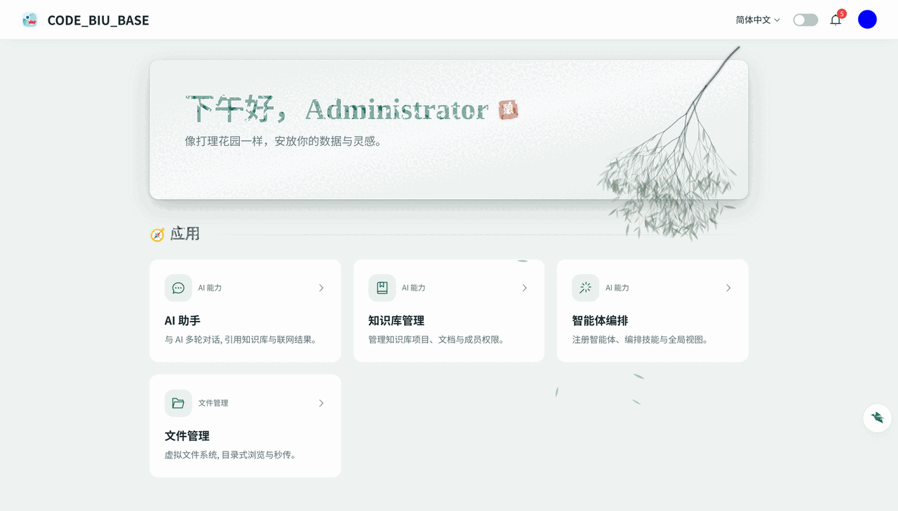
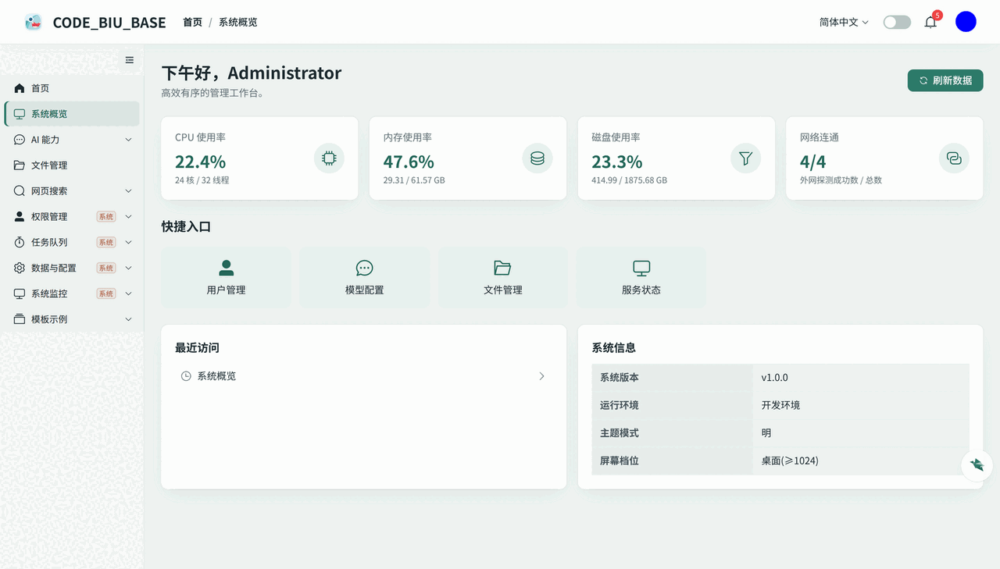
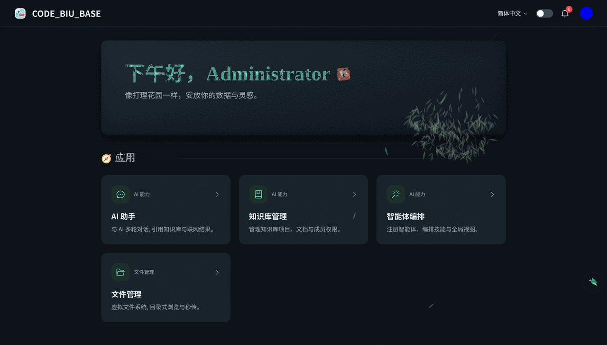
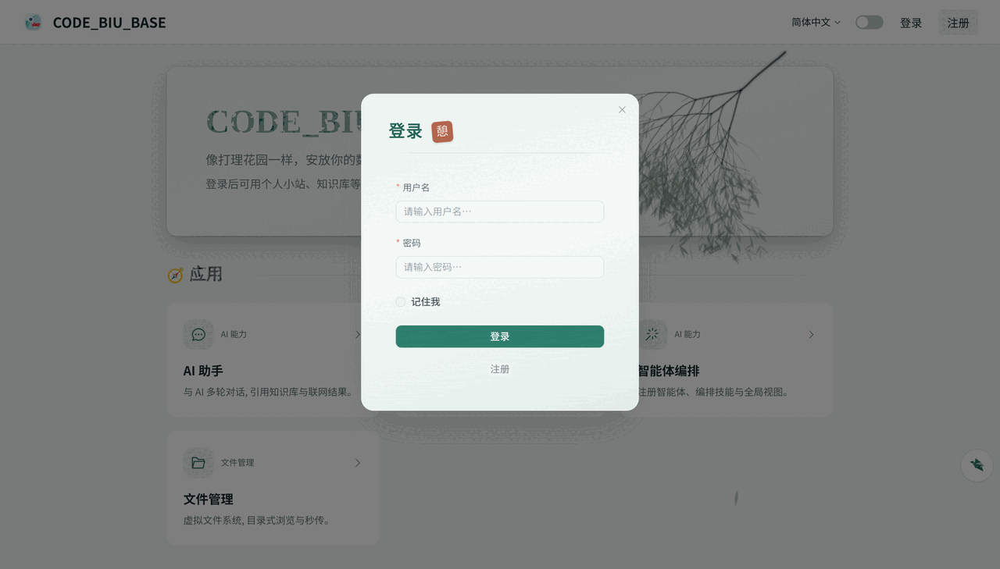
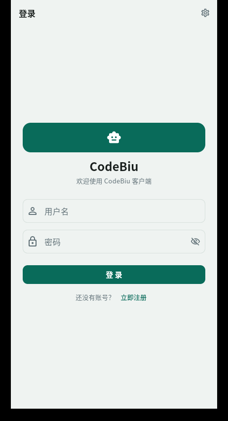
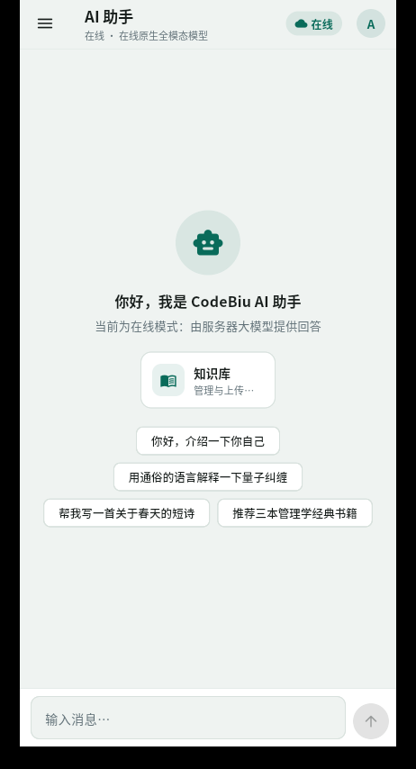
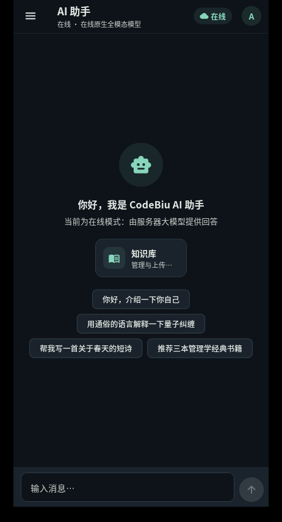

# codebiu_base

[简体中文](README.md) ｜ **English**

A multi-platform starter baseline for fast product delivery: decoupled frontend and backend, documentation and DevOps out of the box. It keeps the reusable foundation — registration and login, RBAC, AI + RAG, files, dictionaries, host monitoring — while dropping business modules and heavyweight dependencies such as torch/transformers. New projects can start by copying this repository.

## Screenshots

**Web app (Vue3, light / dark themes)**

<p align="center">
  
  
</p>
<p align="center">
  
  
</p>

**Cross-platform client (Flutter, phone-sized UI on mobile and PC desktop)**

<p align="center">
  
  
  
</p>

## Repository layout

```
codebiu_base/
├── code/backend/server_py/  # Backend: Python 3.13 + FastAPI + SQLAlchemy 2.0 (async) + PostgreSQL/SQLite
├── code/frontend/vue3/      # Web frontend: Vue3 + TypeScript + Vite + Element Plus + UnoCSS + Pinia
├── code/frontend/flutter/   # Cross-platform client: Flutter (Android/iOS/Linux/Windows/macOS, phone-sized UI)
├── doc/                     # Project-level docs: getting started / design / conventions / test reports
├── deveops/                 # DevOps: environment, Docker, build & release, init, upgrade, backup, app packaging
├── README.md                # Project overview (Simplified Chinese)
├── README.en.md             # Project overview (English, this file)
└── README_AI.md             # Entry point for AI collaboration (workflow + layered rule map)
```

## Core capabilities

| Area | Capability |
| :--- | :--- |
| **Auth & RBAC** | Registration / login (optional email verification), JWT dual tokens, Casbin domain-based RBAC (menus / buttons / APIs), project-level data permissions (member / department tiers) |
| **AI** | Dynamic model configuration isolated by user / department with `public` / `dept` / `user` scopes, streaming LLM chat, rerank, OCR, ASR/TTS (online services only, no local model) |
| **RAG** | Knowledge-base projects / documents / members / department grants, document parsing (MinerU external service, pluggable), chunk vectorization (Milvus / LanceDB), intent-aware QA |
| **Files** | Virtual file tree, upload / download, presigned URLs, instant upload dedup, reference counting, local / S3 storage switching, in-browser preview |
| **Common** | Dictionary management, health checks (CPU / memory / disk / network), data monitoring, dynamic configuration center, async task queue (standalone Celery worker), notification center, operation audit |
| **Cross-platform client** | Flutter "chat-as-entry" AI assistant: sign-in / registration / profile / knowledge base / agent configuration; online (streaming LLM) and local (offline assistant) modes; locally persisted conversation history; new-chat empty-state cards are the default entry point for future features |
| **Engineering** | uv / pnpm, Docker dev & deploy, SQLite + Fakeredis zero-dependency setup (Milvus by default, switchable to LanceDB), Alembic migrations, two web theme templates (toB / toC) |

> This table is an overview only. The authoritative description of module boundaries, data flow and capability scope lives in [总体架构与功能设计](doc/02-设计文档/02-总体架构与功能设计.md) (Chinese); the requirement ledger is [需求功能登记册](doc/02-设计文档/00-需求功能登记册.md).

## Quick start

```bash
# Backend (SQLite + Fakeredis by default; port 6666; switch db_vector.type to lancedb if no local Milvus)
cd code/backend/server_py
uv sync
# config.yaml loads config.dev.yaml by default:
#   - real PostgreSQL/Redis/models: create config.dev.yaml with overrides
#   - zero-dependency baseline: clear config.local_file in config.yaml
python src/app.py            # http://127.0.0.1:6666/docs

# Web frontend (port 8888, proxies /base_server to the backend)
cd code/frontend/vue3
pnpm i
pnpm run dev                 # http://localhost:8888

# Cross-platform client (same phone-sized UI on mobile and desktop; desktop window is a phone shell)
cd code/frontend/flutter
flutter pub get
flutter run -d linux         # desktop; use -d <device-id> from `flutter devices` for a real phone
# Change the backend address in the app: Settings → Server connection (use <dev-machine-ip>:6666 on a phone)
```

Default administrator: `admin / admin123` (`config.yaml` admin section; stored on first start and editable in the config page).

- LLM capabilities need real API keys for chat / embedding / rerank in the config overlay (`config.dev.yaml`) or the built-in configuration page.
- Local environment setup: [开发环境配置](doc/01-入门/3-开发环境.md) (Chinese); first deployment: [配置与数据库初始化](deveops/运维手册/配置与数据库初始化.md) (Chinese).
- Full parameters, directory structure and troubleshooting per component: [backend](code/backend/server_py/README.md) · [Web frontend](code/frontend/vue3/README.md) · [client](code/frontend/flutter/README.md).

## Two web theme templates

| Theme | Entry | Description |
| :--- | :--- | :--- |
| **toB admin** | Avatar menu →「后台管理」→ `admin.vue` workbench | Sidebar layout (SysSidebar + breadcrumbs) hosting system / files / AI / knowledge base / tasks / monitoring pages |
| **toC main app** | Home `index.vue` entry cards | Standalone user-facing front end without a sidebar (currently knowledge-base Q&A) |

See [总体架构与功能设计](doc/02-设计文档/02-总体架构与功能设计.md) for capability boundaries and [前端 05-权限与菜单](code/frontend/vue3/doc/dev/05-权限与菜单.md) for the menu/permission model (both Chinese).

## Documentation

**Document scope, layering and anti-duplication rules are governed by [doc/README.md](doc/README.md) (single source of truth; Chinese).** This file is an entry point only.

| Layer | Entry | What it covers |
| :--- | :--- | :--- |
| Project | [doc/README.md](doc/README.md) | Documentation index, requirement ledger and cards, requirement analysis, architecture, permission design, cross-component conventions, test reports |
| Backend | [server_py/doc](code/backend/server_py/doc/README.md) · [README](code/backend/server_py/README.md) | Layering and directories, config initialization, migrations, permission wiring, AI capabilities, performance, dependencies, version history |
| Web frontend | [vue3/doc](code/frontend/vue3/doc/README.md) · [README](code/frontend/vue3/README.md) | Auto routing, visual theme, styling and responsive rules, menu permissions, version history |
| Client | [flutter/doc](code/frontend/flutter/doc/README.md) · [README](code/frontend/flutter/README.md) | Dev setup and packaging, four-layer architecture, code conventions, onboarding and AI guide, version history |
| DevOps | [deveops](deveops/README.md) | Environment, Docker deployment, build & release, config and DB initialization, upgrades, backup and restore |

**AI collaboration**: start with [README_AI.md](README_AI.md) (global gates and hard rules), then go to [backend AI rules](code/backend/server_py/README_AI.md), [frontend AI rules](code/frontend/vue3/README_AI.md) or [client AI rules](code/frontend/flutter/README_AI.md).

**Deployment and version migration**:

- [Configuration and database initialization](deveops/运维手册/配置与数据库初始化.md): layered config, database creation, first-start table/seed/admin setup, verification and reset.
- [Version upgrade and database migration](deveops/运维手册/版本升级与数据库迁移.md): upgrading a live system from version A to B, data compatibility, rollback.
- [Backend migration mechanism](code/backend/server_py/doc/dev/04-数据库迁移.md): writing Alembic scripts and commands.

**Client packaging & release**: [deveops/运维脚本/app_realse](deveops/运维脚本/app_realse/build_flutter_desktop.sh) builds the desktop app (Linux AppImage + tarball via `build_flutter_desktop.sh`) and Android APKs (per-ABI release via `build_flutter_mobile.sh`) into `dist/` in one command. Windows `.exe` must be built on a Windows machine (Visual Studio).

## Extending the baseline

| Layer | Where to copy / create | Must read |
| :--- | :--- | :--- |
| Backend | Copy `src/module_template/` → `module_xxx/`, register the import in `src/app.py` | [Backend dev guide](code/backend/server_py/doc/dev/01-开发指南.md) · [Permission FAQ](code/backend/server_py/doc/dev/06-权限接入FAQ.md) |
| Web frontend | Create `src/modules/xxx/` (api/components/pages/types, routes auto-generated) and add a `menu.ts` entry | [Frontend dev guide](code/frontend/vue3/doc/dev/01-开发指南.md) · [Permissions and menus](code/frontend/vue3/doc/dev/05-权限与菜单.md) |
| Client | Register a feature card in the chat empty state (`_EmptyView._features`) and create `lib/modules/xxx/` | [Client dev guide](code/frontend/flutter/doc/dev/01-开发指南.md) |

## Versioning

Version number rules, branching strategy and rollback flow are defined in [版本管理](doc/03-规范/版本管理.md) (Chinese); this section is an index only:

- Baseline extraction v1.0.0; current package versions: backend `0.1.1` (`pyproject.toml`), web frontend `1.3.0` (`package.json`), client `0.2.0`
- Per-component change logs: [backend](code/backend/server_py/doc/tag_doc/version_info.md) · [web frontend](code/frontend/vue3/doc/tag_doc/version_info.md) · [client](code/frontend/flutter/doc/tag_doc/version_info.md)

## Community

<!-- WeChat group QR code: save the image as doc/images/screenshots/wechat-qr.png,
     then replace the placeholder below with  -->

| WeChat group | Feedback |
| :---: | :---: |
| QR code placeholder (to be added) | [Open an issue](https://github.com/ITILD/codebiu-base/issues) |

## Contributing

Develop on the `dev` branch and merge into `main` after review; follow [代码规范](doc/03-规范/代码规范.md) and [版本管理](doc/03-规范/版本管理.md). Feature requests must first be registered in the [需求功能登记册](doc/02-设计文档/00-需求功能登记册.md) and approved; bug fixes, documentation, pure refactors and dependency upgrades are exempt.

---

[Back to 简体中文](README.md)
