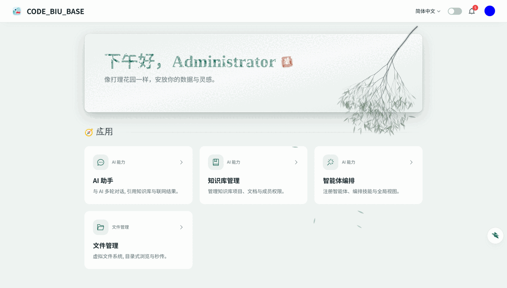
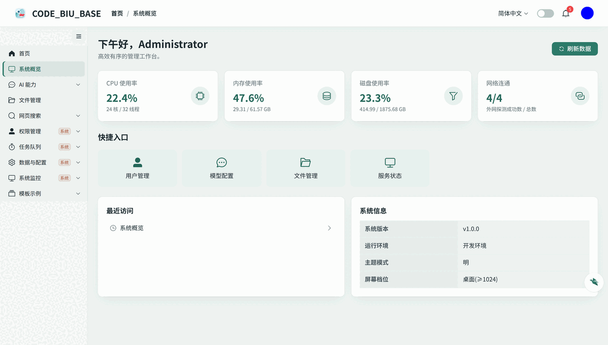
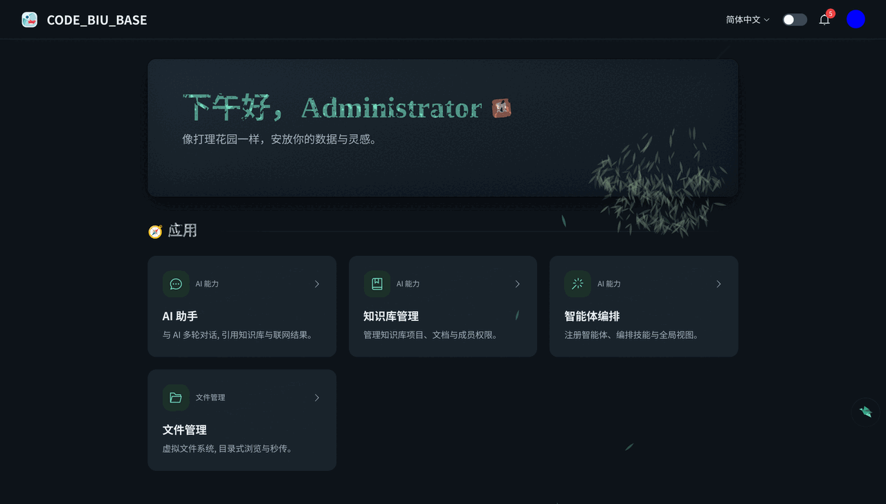
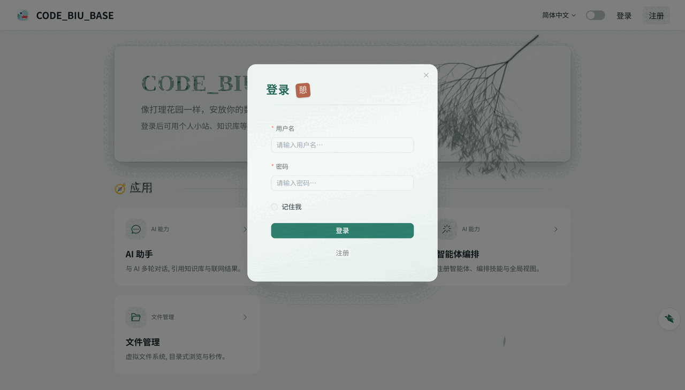
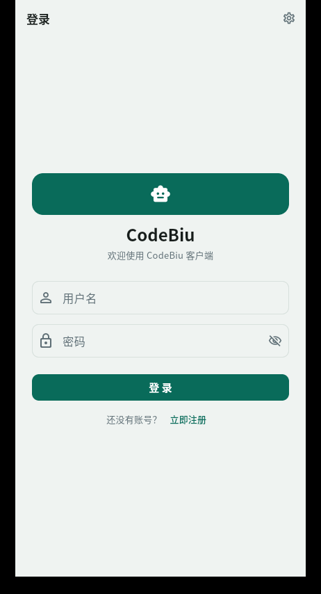
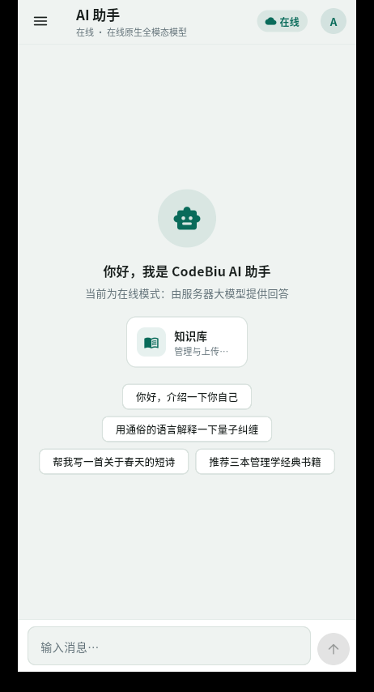
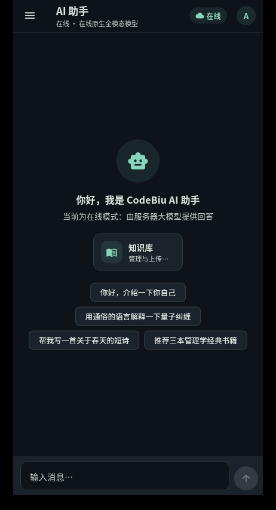

# codebiu_base

**简体中文** ｜ [English](README.en.md)

新一代 **AI 能力平台基线**：以 **Model（模型）/ Skill（技能）/ Agent（智能体）** 三层一等公民为架构主轴，前后端分离、文档与运维一体化。保留注册登录、权限、文件、字典、动态配置、RAG、任务队列等通用底座；新项目复制本仓库后，按「先归类三层，再写业务代码」的方式扩展，不污染公共底座。

## 界面预览

**Web 端（Vue3，亮 / 暗双主题）**

<p align="center">
  
  
</p>
<p align="center">
  
  
</p>

**跨端客户端（Flutter，手机与 PC 桌面同尺寸界面）**

<p align="center">
  
  
  
</p>

## 仓库结构

```
codebiu_base/
├── code/backend/server_py/  # 后端基线：Python 3.13 + FastAPI + SQLAlchemy 2.0(异步) + PostgreSQL/SQLite
├── code/frontend/vue3/      # 前端基线：Vue3 + TypeScript + Vite + Element Plus + UnoCSS + Pinia
├── code/frontend/flutter/   # 跨端客户端基线：Flutter（Android/iOS/Linux/Windows/macOS 手机尺寸界面）
├── doc/                     # 项目级文档：入门 / 设计 / 跨端规范 / 测试报告 / 开发 Skill
│   ├── 02-设计文档/04-AI能力平台架构设计.md   # 三层契约唯一权威
│   ├── 02-设计文档/05-对话智能体与执行协议设计.md
│   ├── 05-开发skill/        # 纯 Markdown prompt skill（可拖入 AI IDE / AI 自动发现）
│   └── doc-manifest.yaml    # 机器可读文档清单与代码映射
├── deveops/                 # 部署运维：环境、Docker、构建发布、初始化、版本升级、备份恢复、客户端打包
├── README.md                # 项目总览（简体中文）
├── README.en.md             # 项目总览（English，与中文版镜像同步）
└── README_AI.md             # AI IDE 唯一入口（全局流程 + 文档先行门禁 + 分层规则地图）
```

## 架构主轴：Model / Skill / Agent

平台只认三种一等公民，抽象与能力逐级增大；每层都有 **ai / static / hybrid** 三种能力来源，规则能力与 AI 能力在契约、队列、治理上完全平权。

```text
Agent 编排层   ai_agent(ReAct) │ static_agent(固定工作流) │ hybrid
      │        例：kb_ingest_agent、builtin_thinking、ops_agent
Skill 能力层   ai_skill │ static_skill │ hybrid
      │        例：doc_parse、doc_chunk_index、sys.container_*
Model 供给层   ai_model(chat/embeddings/rerank/ocr/asr/tts) │ static_func(固定规则函数)
      │        例：Qwen 主模型、MinerU 解析引擎(经 Skill 包装)、哈希/正则/校验器
Service 领域层 领域逻辑 / 事务 / 权限过滤 / DAO（既有，不变）
```

- **依赖单向**：`Agent → Skill → Model(可选) → Service`；Model 不调用任何东西，Skill 不互相编排，Agent 不调用 Agent。
- **三条入口一个运行时**：页面 Controller、对话 Agent Tool Adapter、Celery Task Executor 全部汇合到 `SkillRuntime.invoke()`，同一 Skill 只有一份实现，inline / queued 只是两种外壳。
- **零模型可运行**：`static_func / static_skill / rule Agent` 在无任何模型配置时仍可运行；不强制使用 AI。
- **新功能先归类**：模型或固定规则函数 → Model；单次、可复用的执行单元 → Skill；多步编排或会话上下文 → Agent；普通 CRUD / 展示 → Controller + Service。

权威契约见 [04-AI能力平台架构设计](doc/02-设计文档/04-AI能力平台架构设计.md)，对话执行协议见 [05-对话智能体与执行协议设计](doc/02-设计文档/05-对话智能体与执行协议设计.md)。

## 核心能力

| 层 / 域 | 能力 |
| :--- | :--- |
| **Model 供给层** | 模型动态配置（按用户/部门隔离 public/dept/user 三作用域）、LLM 对话/Embeddings/Rerank/OCR/ASR/TTS 纯在线接入、`static_func` 固定规则函数注册表（哈希、格式识别、正则抽取、校验器） |
| **Skill 能力层** | Skill Manifest 契约（input/output schema、幂等键、执行形态、能力声明）、SkillRuntime 统一调用、内置/自定义/社区 SKILL.md 包/MCP 适配、`doc_parse`、`doc_chunk_index`、`sys.container_*`、prompt 与 script 沙箱 |
| **Agent 编排层** | `ai_agent` 有界 ReAct、`static_agent` 固定工作流、`hybrid`、内置对话 Agent（fast / thinking / deep）、五拍协议与验收闸门、`kb_ingest_agent`、`ops_agent` |
| **执行与观测** | 三条触发入口、物理队列（`q_interactive` / `q_agent_job` / `q_task`）、`skill_invocation`、`agent_job_run`、`agent_plan_item` / `agent_plan_event` |
| **通用底座** | 注册登录（邮箱验证码开关）、JWT 双令牌、Casbin 域分离 RBAC、项目级数据权限、文件虚拟树/秒传/预签名、字典、动态配置中心、通知中心、操作审计、健康检测、Celery 任务队列 |
| **工程** | uv / pnpm 包管理、Docker 开发部署、SQLite + Fakeredis 零依赖组合（向量库默认 Milvus，零依赖可切 LanceDB）、Alembic 数据库迁移、两套前端主题模板（toB/toC） |

> 上表只做概览；三层契约、执行协议与能力边界的权威描述见 [04-AI能力平台架构设计](doc/02-设计文档/04-AI能力平台架构设计.md) 与 [05-对话智能体与执行协议设计](doc/02-设计文档/05-对话智能体与执行协议设计.md)，需求台账见 [需求功能登记册](doc/02-设计文档/00-需求功能登记册.md)。

## 快速开始

```bash
# 后端（默认 SQLite + Fakeredis；端口 6666；无本地 Milvus 时把 db_vector.type 改为 lancedb）
cd code/backend/server_py
uv sync
# config.yaml 默认加载 config.dev.yaml：
#   - 想用真实 PostgreSQL/Redis/模型：新建 config.dev.yaml 写覆盖项
#   - 只想跑零依赖基线：把 config.yaml 的 config.local_file 置空
python src/app.py            # http://127.0.0.1:6666/docs

# 前端（端口 8888）
cd code/frontend/vue3
pnpm i
pnpm run dev                 # http://localhost:8888（代理 /base_server → 后端）

# 跨端客户端（手机与 PC 桌面同构，桌面窗口 420×880 手机尺寸）
cd code/frontend/flutter
flutter pub get
flutter run -d linux          # 桌面；真机用 flutter devices 查 id 后 -d <id>
# App 内「设置 → 服务器连接」改后端地址（真机填开发机 IP:6666）
```

默认管理员：`admin / admin123`（`config.yaml` admin 段，首启入库后可在 通用配置页 修改）。

- 大模型能力需在覆盖层 `config.dev.yaml`（或 通用配置页）填入真实 API Key（对话/向量化/重排等）；不配模型时 `static_*` 能力链路仍可运行。
- 数据库 / docker 环境安装见 [开发环境配置](doc/01-入门/3-开发环境.md)；首次部署见 [配置与数据库初始化](deveops/运维手册/配置与数据库初始化.md)。
- 各端完整参数、目录结构与排错见各端 README：[后端](code/backend/server_py/README.md) · [Web 前端](code/frontend/vue3/README.md) · [客户端](code/frontend/flutter/README.md)。

## 前端两套主题模板

| 主题 | 入口 | 说明 |
| :--- | :--- | :--- |
| **toB 后台管理** | 登录后头像下拉「后台管理」→ `admin.vue` 工作台 | 侧边栏布局（SysSidebar + 面包屑），承载系统管理/文件/AI/知识库/技能与智能体/任务/监控等后台页面 |
| **toC 主应用** | 首页 `index.vue` 入口卡 | 无侧边栏的独立前台（当前挂载知识库问答），面向终端用户 |

功能边界与模块划分见 [总体架构与功能设计](doc/02-设计文档/02-总体架构与功能设计.md)；菜单与权限驱动方式见 [前端 05-权限与菜单](code/frontend/vue3/doc/dev/05-权限与菜单.md)。

## 文档导航

**文档范围、分层归属与防冗余规则以 [doc/README.md](doc/README.md) 为唯一事实来源**（本文件只做入口，不重复定义）。

| 层 | 入口 | 读什么 |
| :--- | :--- | :--- |
| 项目级 | [doc/README.md](doc/README.md) | 文档总索引、需求登记册与需求卡、需求分析、总体架构、AI 三层架构、对话执行协议、权限设计、跨端规范、测试报告 |
| 开发 Skill | [doc/05-开发skill/README.md](doc/05-开发skill/README.md) | 需求登记、三层归类、代码导入回收、文档同步巡检、模块骨架、交付验收（纯 Markdown，可拖入 AI IDE） |
| 后端 | [server_py/doc](code/backend/server_py/doc/README.md) · [README](code/backend/server_py/README.md) | 分层与目录、配置初始化、数据库迁移、权限接入、AI 能力、性能、依赖、版本记录 |
| Web 前端 | [vue3/doc](code/frontend/vue3/doc/README.md) · [README](code/frontend/vue3/README.md) | 自动路由、视觉主题、样式与响应式规范、菜单权限、版本记录 |
| 客户端 | [flutter/doc](code/frontend/flutter/doc/README.md) · [README](code/frontend/flutter/README.md) | 开发部署与打包、四层分层方案、代码规范、新成员与 AI 协作指南、版本记录 |
| 运维 | [deveops](deveops/README.md) | 环境准备、Docker 部署、打包构建、配置与数据库初始化、跨版本升级、备份恢复 |

**AI 协作**：先读 [README_AI.md](README_AI.md)（AI IDE 唯一入口、文档先行门禁、代码-文档同步协议），再按需进入 [后端 AI 规则](code/backend/server_py/README_AI.md)、[前端 AI 规则](code/frontend/vue3/README_AI.md) 或 [客户端 AI 规则](code/frontend/flutter/README_AI.md)。

**部署与版本迁移**：

- [配置与数据库初始化](deveops/运维手册/配置与数据库初始化.md)：配置分层、建库、首启建表/种子/管理员、验证与重置。
- [版本升级与数据库迁移](deveops/运维手册/版本升级与数据库迁移.md)：已上线系统从版本 A 升到 B、数据兼容、回滚。
- [后端数据库迁移机制](code/backend/server_py/doc/dev/04-数据库迁移.md)：Alembic 脚本编写与命令。

**客户端打包发布**：[deveops/运维脚本/4-客户端](deveops/运维脚本/4-客户端/) 一键产出桌面端（Linux AppImage + tar.gz，`build_desktop.sh`）与手机端（Android 分架构 APK，`build_android.sh`）；产物统一在 `dist/`。Windows exe 需在 Windows 机器（Visual Studio）上构建。

## 新功能扩展指南

**第一步永远是归类，而不是直接写代码。** 判定树与契约见 [04-AI能力平台架构设计 §2.6](doc/02-设计文档/04-AI能力平台架构设计.md)。

| 需求类型 | 放哪 | 必读 |
| :--- | :--- | :--- |
| **Model**：接入新模型 / 固定规则函数 | `model_config`（ai_model）或 `module_ai/functions/`（static_func），不新增业务代码 | 04 §2.2 |
| **Skill**：单次、无状态、可复用执行单元 | `module_xxx/skills/<key>/manifest.py + impl.py`，薄包装调 Service | 04 §3.1、[后端开发指南](code/backend/server_py/doc/dev/01-开发指南.md) |
| **Agent**：多步编排 / 会话角色 | 代码 Manifest 或 `module_agent/agents/`，优先 static_agent / 有界 ReAct | 04 §3.3、[05 执行协议](doc/02-设计文档/05-对话智能体与执行协议设计.md) |
| **普通业务功能**：CRUD / 展示 / 审批流 | 后端 `module_xxx/`，前端 `src/modules/xxx/` + `menu.ts` | [开发流程](doc/03-规范/开发流程.md) |
| **客户端功能** | 对话空态 `_EmptyView._features` 注册卡片 → `lib/modules/xxx/` | [客户端开发指南](code/frontend/flutter/doc/dev/01-开发指南.md) |

## AI 协作与文档先行

本仓库把「AI 可读、可执行」作为一等需求，而不是附加说明：

1. **唯一 AI 入口**：[README_AI.md](README_AI.md)。任何 AI IDE 开始工作前必须先读它，再读 [doc/README.md](doc/README.md) 与对应端 `README_AI.md`。
2. **文档先行门禁**：新需求先改 `doc/`（登记册 + 需求卡 + 设计/契约），状态置「已批准」后才允许写代码；缺陷/文档/纯重构/依赖升级走豁免，但仍要在登记册「变更记录」留痕。
3. **代码-文档同步**：关键代码入口带 `@doc-sync` 标记，`doc/doc-manifest.yaml` 维护文档与代码映射；外部传入或手工修改的代码，合入前必须执行「代码导入与文档回收」流程。
4. **开发 Skill**：[doc/05-开发skill/](doc/05-开发skill/README.md) 提供纯 Markdown prompt skill。可手工拖入 AI IDE，也可由 AI 自动发现；选中后在对话框补充本次细节即可。后期可平滑升级为带脚本的 skill。

## 版本管理

版本号规则、分支策略与回滚流程统一见 [版本管理规范](doc/03-规范/版本管理.md)，本条只做索引：

- 基线抽取 v1.0.0；当前包版本：后端 `0.1.1`（`pyproject.toml`）、前端 `1.3.0`（`package.json`）、客户端 `0.2.0`
- 各端变更记录：[后端](code/backend/server_py/doc/tag_doc/version_info.md) · [前端](code/frontend/vue3/doc/tag_doc/version_info.md) · [客户端](code/frontend/flutter/doc/tag_doc/version_info.md)

## 社区与交流

<!-- 微信群二维码：把二维码图片保存为 doc/images/screenshots/wechat-qr.png，
     再将下方「二维码位置（待补充）」替换为  -->

| 微信交流群 | 问题反馈 |
| :---: | :---: |
| 二维码位置（待补充） | [提交 Issue](https://github.com/ITILD/codebiu-base/issues) |

## 贡献方式

分支 `dev` 开发，PR 审查后合入 `main`；遵循 [代码规范](doc/03-规范/代码规范.md) 与 [版本管理](doc/03-规范/版本管理.md)。功能需求先登记 [需求功能登记册](doc/02-设计文档/00-需求功能登记册.md) 并获批，同时按 [文档先行流程](doc/05-开发skill/02-三层归类与文档先行.md) 更新设计与契约；缺陷/文档/纯重构/依赖升级走豁免。
