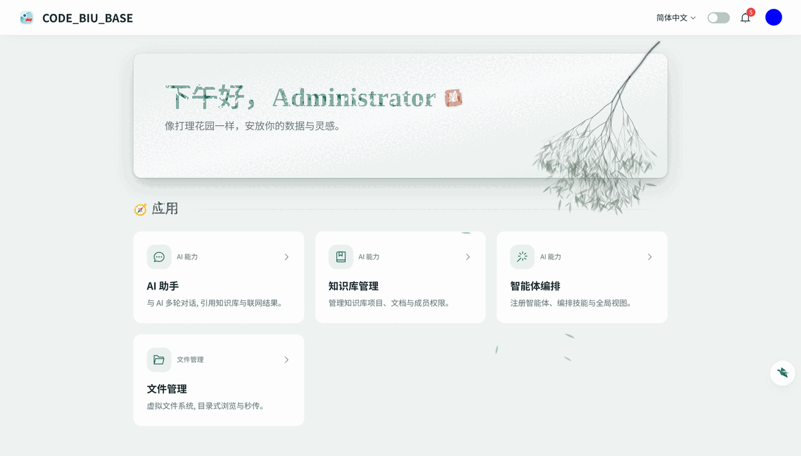
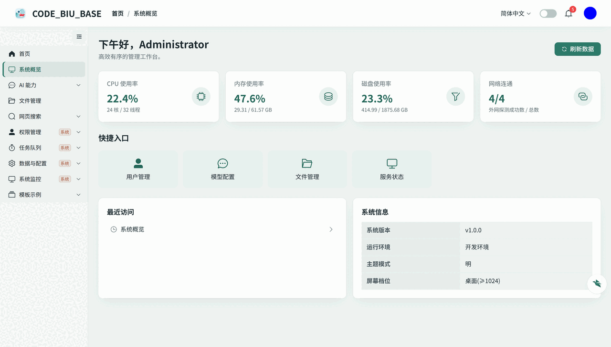
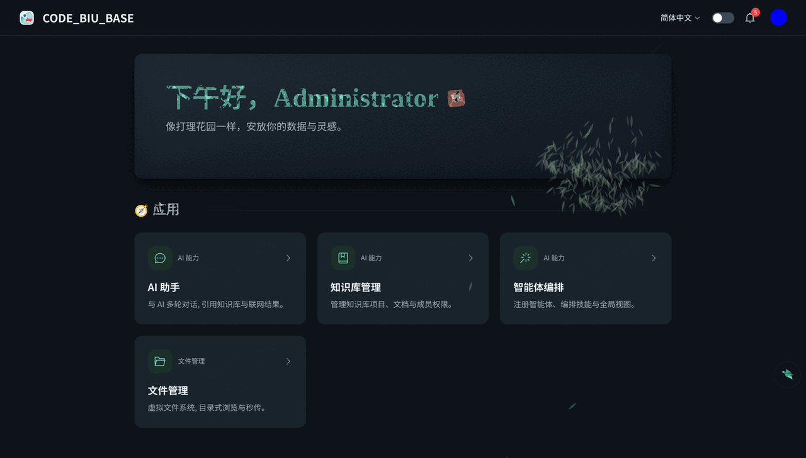
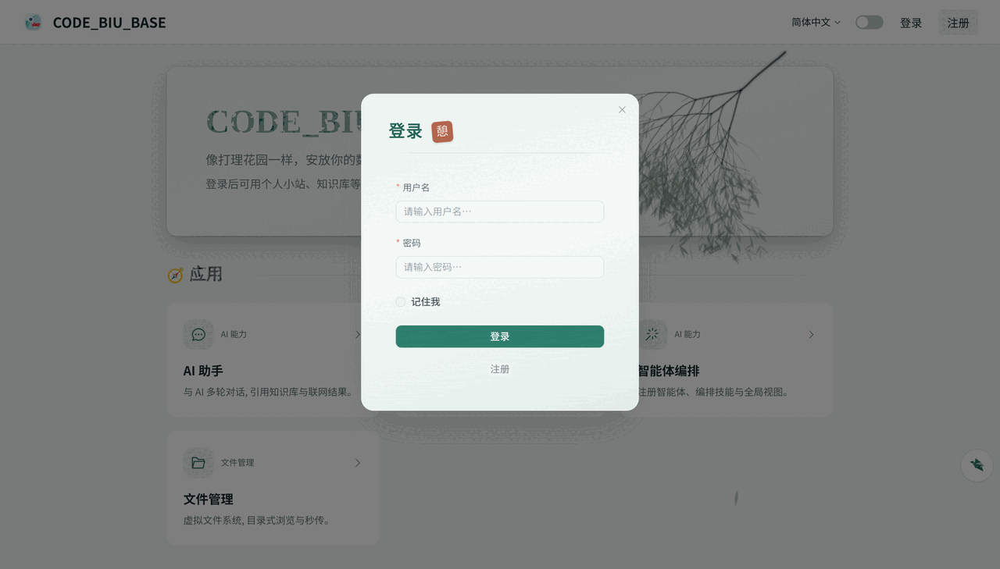
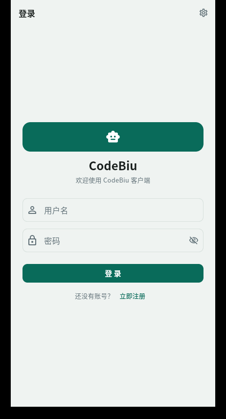
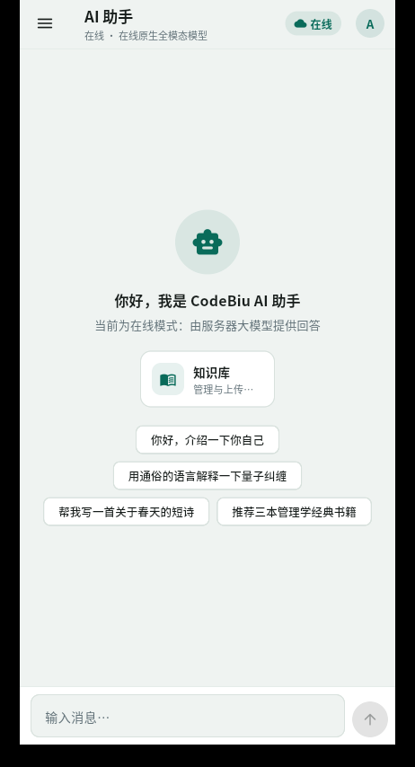
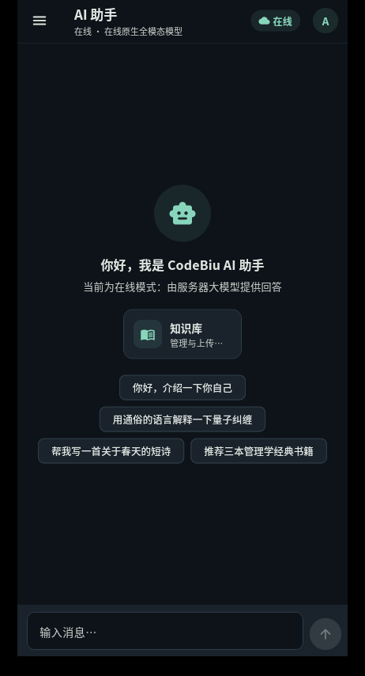

# codebiu_base

**简体中文** ｜ [English](README.en.md)

多平台快速开发部署基线：前后端分离 + 文档 + 运维一体化。保留注册登录、权限、AI + RAG、文件、字典、主程序检测等通用底座，剥离业务模块与 torch/transformers 等重型依赖，新项目可直接复制起步。

## 界面预览

**Web 端（Vue3，亮 / 暗双主题）**

<p align="center">
  
  
</p>
<p align="center">
  
  
</p>

**跨端客户端（Flutter，手机与 PC 桌面同尺寸界面）**

<p align="center">
  
  
  
</p>

## 仓库结构

```
codebiu_base/
├── code/backend/server_py/  # 后端基线：Python 3.13 + FastAPI + SQLAlchemy 2.0(异步) + PostgreSQL/SQLite
├── code/frontend/vue3/      # 前端基线：Vue3 + TypeScript + Vite + Element Plus + UnoCSS + Pinia
├── code/frontend/flutter/   # 跨端客户端基线：Flutter（Android/iOS/Linux/Windows/macOS 手机尺寸界面）
├── doc/                     # 项目级文档：入门 / 设计 / 跨端规范 / 测试报告
├── deveops/                 # 部署运维：环境、Docker、构建发布、初始化、版本升级、备份恢复、客户端打包
├── README.md                # 项目总览（简体中文）
├── README.en.md             # 项目总览（English，与中文版镜像同步）
└── README_AI.md             # AI 协作总入口（全局流程 + 分层规则地图）
```

## 核心能力

| 域 | 能力 |
| :--- | :--- |
| **认证权限** | 注册登录（支持邮箱验证码开关）、JWT 双令牌、Casbin 域分离 RBAC（菜单/按钮/接口）、项目级数据权限（成员/部门三档位） |
| **AI** | 模型动态配置（按用户/部门隔离 public/dept/user）、LLM 流式对话、重排、OCR、语音 ASR/TTS（纯在线服务接入，无本地大模型） |
| **RAG** | 知识库项目/文档/成员/部门授权、文档解析（MinerU 外部服务调用，接口可扩展其他解析服务）、分块向量化（Milvus/LanceDB）、意图分析问答 |
| **文件** | 虚拟文件树、上传下载、预签名 URL、秒传去重、引用计数、local/S3 存储切换、在线预览 |
| **通用** | 字典管理、健康检测（CPU/内存/磁盘/网络）、数据监测、通用动态配置中心、异步任务队列（Celery worker 独立进程）、通知中心、操作审计 |
| **跨端客户端** | Flutter「对话即入口」AI 助手：登录注册/用户中心/知识库管理/智能体配置；在线（LLM 流式）与本地（离线助手）双模式；会话历史本地持久化；新对话空态功能卡片为后续新功能默认入口 |
| **工程** | uv / pnpm 包管理、docker 开发部署、SQLite + Fakeredis 本地组合（向量库默认 Milvus，零依赖可切 LanceDB）、Alembic 数据库迁移、两套前端主题模板（toB/toC） |

> 上表只做概览；模块划分、数据流与能力边界的权威描述见 [总体架构与功能设计](doc/02-设计文档/02-总体架构与功能设计.md)，需求台账见 [需求功能登记册](doc/02-设计文档/00-需求功能登记册.md)。

## 快速开始

```bash
# 后端（默认 SQLite + Fakeredis；端口 6666；无本地 Milvus 时把 db_vector.type 改为 lancedb）
cd code/backend/server_py
uv sync
# config.yaml 默认加载 config.dev.yaml：
#   - 想用真实 PostgreSQL/Redis/模型：新建 config.dev.yaml 写覆盖项
#   - 只想跑零依赖基线：把 config.yaml 的 config.local_file 置空
python src/app.py            # http://127.0.0.1:6666/docs

# 前端（端口 8888）
cd code/frontend/vue3
pnpm i
pnpm run dev                 # http://localhost:8888（代理 /base_server → 后端）

# 跨端客户端（手机与 PC 桌面同构，桌面窗口 420×880 手机尺寸）
cd code/frontend/flutter
flutter pub get
flutter run -d linux          # 桌面；真机用 flutter devices 查 id 后 -d <id>
# App 内「设置 → 服务器连接」改后端地址（真机填开发机 IP:6666）
```

默认管理员：`admin / admin123`（`config.yaml` admin 段，首启入库后可在 通用配置页 修改）。

- 大模型能力需在覆盖层 `config.dev.yaml`（或 通用配置页）填入真实 API Key（对话/向量化/重排等）。
- 数据库 / docker 环境安装见 [开发环境配置](doc/01-入门/3-开发环境.md)；首次部署见 [配置与数据库初始化](deveops/运维手册/配置与数据库初始化.md)。
- 各端完整参数、目录结构与排错见各端 README：[后端](code/backend/server_py/README.md) · [Web 前端](code/frontend/vue3/README.md) · [客户端](code/frontend/flutter/README.md)。

## 前端两套主题模板

| 主题 | 入口 | 说明 |
| :--- | :--- | :--- |
| **toB 后台管理** | 登录后头像下拉「后台管理」→ `admin.vue` 工作台 | 侧边栏布局（SysSidebar + 面包屑），承载系统管理/文件/AI/知识库/任务/监控等后台页面 |
| **toC 主应用** | 首页 `index.vue` 入口卡 | 无侧边栏的独立前台（当前挂载知识库问答），面向终端用户 |

功能边界与模块划分见 [总体架构与功能设计](doc/02-设计文档/02-总体架构与功能设计.md)；菜单与权限驱动方式见 [前端 05-权限与菜单](code/frontend/vue3/doc/dev/05-权限与菜单.md)。

## 文档导航

**文档范围、分层归属与防冗余规则以 [doc/README.md](doc/README.md) 为唯一事实来源**（本文件只做入口，不重复定义）。

| 层 | 入口 | 读什么 |
| :--- | :--- | :--- |
| 项目级 | [doc/README.md](doc/README.md) | 文档总索引、需求登记册与需求卡、需求分析、总体架构、权限设计、跨端规范、测试报告 |
| 后端 | [server_py/doc](code/backend/server_py/doc/README.md) · [README](code/backend/server_py/README.md) | 分层与目录、配置初始化、数据库迁移、权限接入、AI 能力、性能、依赖、版本记录 |
| Web 前端 | [vue3/doc](code/frontend/vue3/doc/README.md) · [README](code/frontend/vue3/README.md) | 自动路由、视觉主题、样式与响应式规范、菜单权限、版本记录 |
| 客户端 | [flutter/doc](code/frontend/flutter/doc/README.md) · [README](code/frontend/flutter/README.md) | 开发部署与打包、四层分层方案、代码规范、新成员与 AI 协作指南、版本记录 |
| 运维 | [deveops](deveops/README.md) | 环境准备、Docker 部署、打包构建、配置与数据库初始化、跨版本升级、备份恢复 |

**AI 协作**：先读 [README_AI.md](README_AI.md)（全局门禁与硬规则），再按需进入 [后端 AI 规则](code/backend/server_py/README_AI.md)、[前端 AI 规则](code/frontend/vue3/README_AI.md) 或 [客户端 AI 规则](code/frontend/flutter/README_AI.md)。

**部署与版本迁移**：

- [配置与数据库初始化](deveops/运维手册/配置与数据库初始化.md)：配置分层、建库、首启建表/种子/管理员、验证与重置。
- [版本升级与数据库迁移](deveops/运维手册/版本升级与数据库迁移.md)：已上线系统从版本 A 升到 B、数据兼容、回滚。
- [后端数据库迁移机制](code/backend/server_py/doc/dev/04-数据库迁移.md)：Alembic 脚本编写与命令。

**客户端打包发布**：[deveops/运维脚本/app_realse](deveops/运维脚本/app_realse/build_flutter_desktop.sh) 一键产出桌面端（Linux AppImage + tar.gz，`build_flutter_desktop.sh`）与手机端（Android 分架构 APK，`build_flutter_mobile.sh`）；产物统一在 `dist/`。Windows exe 需在 Windows 机器（Visual Studio）上构建。

## 新模块扩展指南

| 端 | 复制/新建位置 | 必读 |
| :--- | :--- | :--- |
| 后端 | 复制 `src/module_template/` → `module_xxx/`，在 `src/app.py` 注册 import | [后端开发指南](code/backend/server_py/doc/dev/01-开发指南.md) · [权限接入FAQ](code/backend/server_py/doc/dev/06-权限接入FAQ.md) |
| Web 前端 | `src/modules/xxx/`（api/components/pages/types 聚合，路由自动生成）+ `menu.ts` 菜单项 | [前端开发指南](code/frontend/vue3/doc/dev/01-开发指南.md) · [权限与菜单](code/frontend/vue3/doc/dev/05-权限与菜单.md) |
| 客户端 | 在对话页空态 `_EmptyView._features` 注册功能卡片 → 新建 `lib/modules/xxx/` | [客户端开发指南](code/frontend/flutter/doc/dev/01-开发指南.md) |

## 版本管理

版本号规则、分支策略与回滚流程统一见 [版本管理规范](doc/03-规范/版本管理.md)，本条只做索引：

- 基线抽取 v1.0.0；当前包版本：后端 `0.1.1`（`pyproject.toml`）、前端 `1.3.0`（`package.json`）、客户端 `0.2.0`
- 各端变更记录：[后端](code/backend/server_py/doc/tag_doc/version_info.md) · [前端](code/frontend/vue3/doc/tag_doc/version_info.md) · [客户端](code/frontend/flutter/doc/tag_doc/version_info.md)

## 社区与交流

<!-- 微信群二维码：把二维码图片保存为 doc/images/screenshots/wechat-qr.png，
     再将下方「二维码位置（待补充）」替换为  -->

| 微信交流群 | 问题反馈 |
| :---: | :---: |
| 二维码位置（待补充） | [提交 Issue](https://github.com/ITILD/codebiu-base/issues) |

## 贡献方式

分支 `dev` 开发，PR 审查后合入 `main`；遵循 [代码规范](doc/03-规范/代码规范.md) 与 [版本管理](doc/03-规范/版本管理.md)。功能需求先登记 [需求功能登记册](doc/02-设计文档/00-需求功能登记册.md) 并获批；缺陷/文档/纯重构/依赖升级走豁免。
