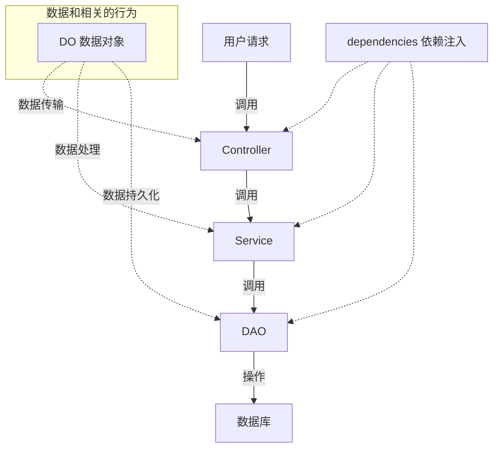

# 后端开发指南

> 基线库 `code/backend/server_py`：Python 3.13 + FastAPI + SQLAlchemy 2.0(异步) + PostgreSQL。

## 1. 启动与调试

```bash
cd code/backend/server_py

# 安装依赖(uv 自动管理 Python 3.13 虚拟环境)
uv sync

# 复制/新建覆盖配置（config.yaml 的 config.local_file 默认指向 config.dev.yaml）
# 只跑零依赖基线时，把 config.local_file 置空

# 方式一: 直接运行(会自动结束旧进程)
python src/app.py

# 方式二: 控制台 uvicorn(支持 reload)
PYTHONPATH=src uv run uvicorn app:app --host 0.0.0.0 --port 6666 --reload
```

启动成功后访问 Swagger 文档：`http://127.0.0.1:6666/docs`

## 2. 目录结构

`src/` 下按 `common/`（公共配置与工具）+ `module_*`（业务模块）划分，完整树与模块边界见 [02-目录结构](02-目录结构.md)。

## 3. MVC 分层与请求链路



| 层 | 目录 | 职责 | 约定 |
| :---: | :---: | :--- | :--- |
| Controller | `controller/` | 路由定义、参数校验、调 Service、返回 DO | 不写业务逻辑 |
| Service | `service/` | 业务逻辑、跨 DAO 组合 | 事务由 `@DaoRel` 托管 |
| DAO | `dao/` | 单表 CRUD 封装 | 方法挂 `@DaoRel` 装饰器 |
| DO | `do/` | 表模型 + Create/Update Pydantic 模型 | 命名 `XxxCreate`/`XxxUpdate` |
| Config | `config/` | 模块子应用挂载、模块级配置 | `server.py` 固定写法 |
| Dependencies | `dependencies/` | FastAPI 依赖注入工厂 | 如 `get_xxx_service` |

## 4. 新模块开发六步法

以 `module_demo` 为例，参考 `module_template`：

### ① 创建目录与路由挂载

`src/module_demo/config/server.py`：

```python
from common.config.server import app
from fastapi import FastAPI
import logging

logger = logging.getLogger(__name__)

module_app = FastAPI()
app.mount("/demo", module_app)  # 模块统一挂载到子路径

logger.info("ok...server module_demo服务配置")
```

### ② 定义数据对象 do/

`do/demo.py` 定义表模型与出入参模型：

```python
# 表模型(SQLModel) + Pydantic 模式(Create/Update)
class Demo(SQLModel, table=True):
    id: str = Field(default_factory=lambda: str(uuid4()))
    name: str
    is_active: bool = True

class DemoCreate(BaseModel):
    name: str
```

### ③ DAO 数据访问层 dao/

```python
from common.utils.db.decorator import DaoRel  # 事务装饰器

class DemoDAO:
    @DaoRel
    async def get_all(self, session: AsyncSession | None = None):
        """查询全部示例数据"""
        statement = select(Demo).where(Demo.is_active == True)  # noqa: E712
        return (await session.exec(statement)).all()
```

### ④ Service 业务层 service/

组合多个 DAO；异常抛 `ValueError`，由 Controller 转 HTTP 状态码。

### ⑤ Controller 路由层 controller/

```python
from module_demo.config.server import module_app
from module_demo.dependencies.demo import get_demo_service

router = APIRouter()

@router.get("/list", response_model=list[Demo])
async def list_demo(service = Depends(get_demo_service)):
    """查询示例列表"""
    return await service.list_all()

# 文件末尾统一注册到模块子应用
module_app.include_router(router, prefix="/demo", tags=["示例模块"])
```

### ⑥ 主应用引入

`src/app.py` 添加：

```python
from module_demo.controller import demo  # noqa: F401 触发路由注册
```

## 5. 数据库与配置

- **配置分层**：`config.yaml`(基线, 入 git, 零依赖默认) → `config.**.yaml`(覆盖层, gitignored, 由 `config.local_file` 指定) → `CODEBIU_*` 环境变量(最高优先级)。详见 [03-配置与初始化](03-配置与初始化.md)。
- **首启建表**：启动时按 DO 自动创建缺失表（幂等），全新库自动 `alembic stamp head`；**启动不会自动升级**。
- **结构演进**：改模型后必须生成 Alembic 增量脚本并审查，见 [04-数据库迁移](04-数据库迁移.md)。
- **分页**：统一用 `common/utils/db/schema/pagination.py` 的 `PaginationParams` / `PaginationResponse` 与 `InfiniteScrollParams` / `InfiniteScrollResponse`。
- **Python 语法**：类型标注用 `str | None`，**不使用** `typing.Optional`/`Union`。

## 6. 测试

```bash
# 运行全部测试
uv run pytest

# vscode settings.json 推荐 pytest 参数
{
  "python.testing.pytestArgs": ["-v", "-s", "--log-cli-level=INFO"]
}
```

## 7. 常见问题

| 现象 | 排查 |
| :--- | :--- |
| 端口占用 | `app.py` 启动会自动 kill 旧进程；手动查 `netstat -ano \| findstr 6666` |
| 模块路由 404 | 确认 `app.py` 引入了 controller；确认 `include_router` 在模块 controller 文件末尾执行 |
| 表未生成 | 检查 DO 是否被 `db.py` 的模型注册引用 |
| 权限 403 | 路由挂了 `require_permission` 但 casbin 未声明规则(见权限体系文档) |

> 相关：[前端开发指南](../../../../frontend/vue3/doc/dev/01-开发指南.md) · [权限体系与接入](05-权限体系与接入.md) · [配置与初始化](03-配置与初始化.md) · [数据库迁移](04-数据库迁移.md) · [开发环境配置](../../../../../doc/01-入门/3-开发环境.md) · [代码规范](../../../../../doc/03-规范/代码规范.md)
